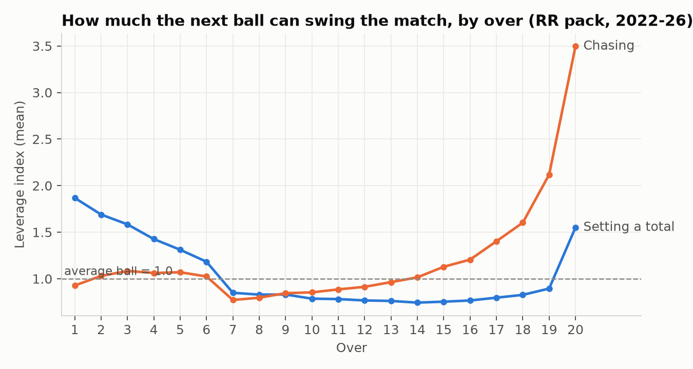
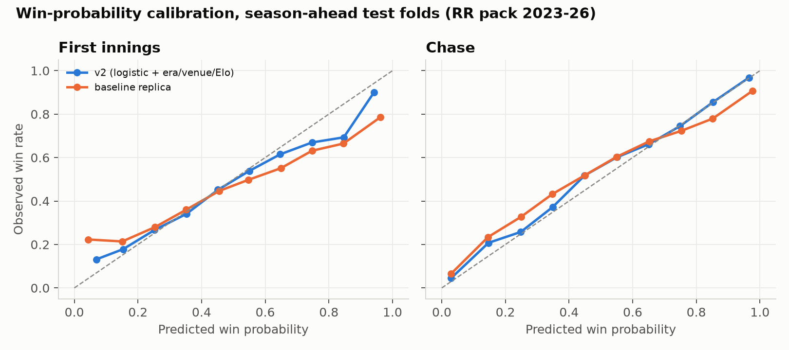
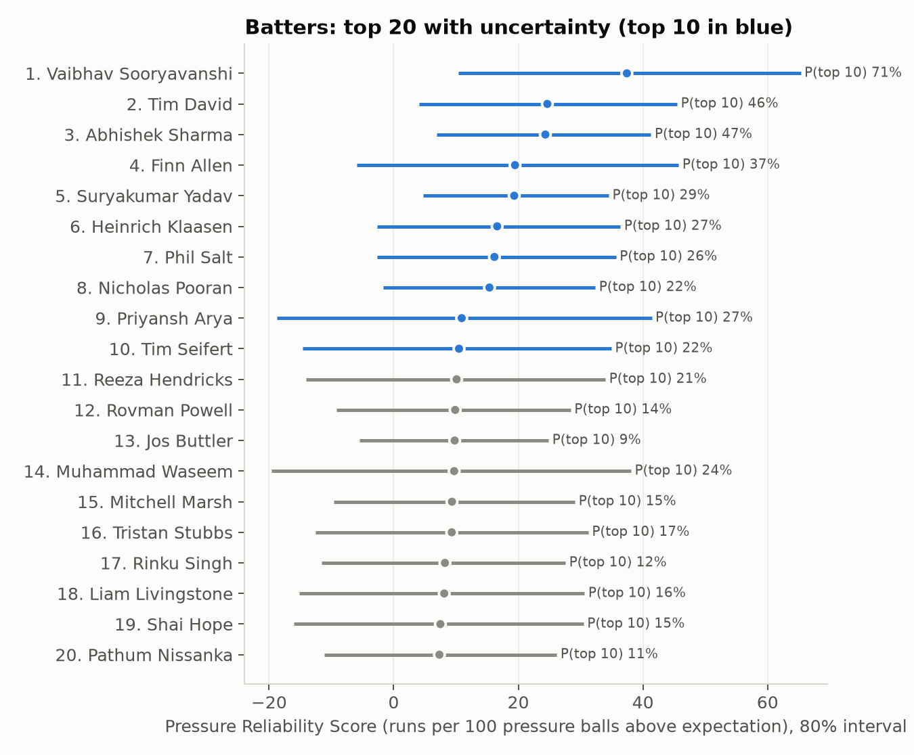
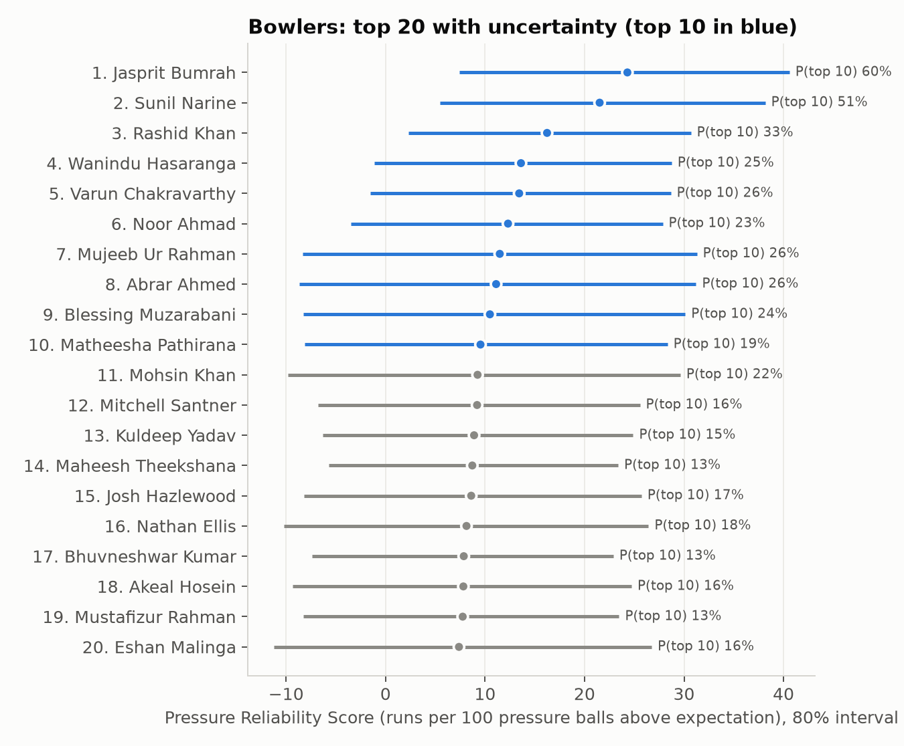
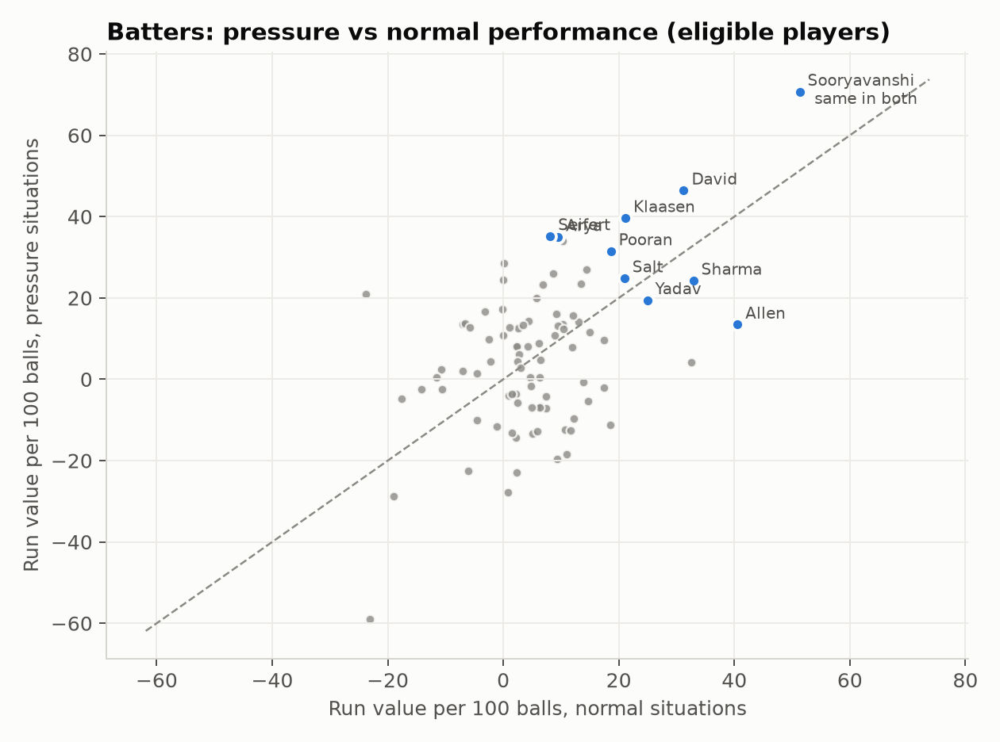
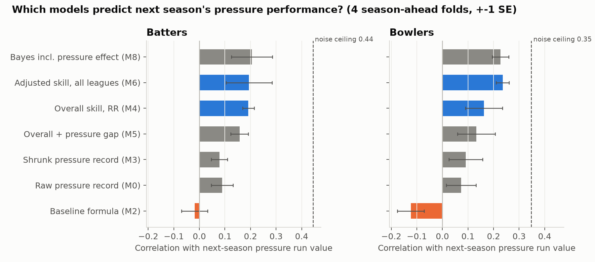

# Headline

We rank batters and bowlers by the run value they are expected to add **per pressure ball next season** - runs above the expectation for the exact match situation, with a wicket costing 5.6 runs - estimated with a hierarchical Bayesian model and validated on seasons it was not trained on.

**Three findings drive the method:**

1. *Clutch is not a repeatable skill in this data.* Adding a player-specific "pressure gap" to overall skill made next-season predictions worse for batters (-0.034 correlation) and bowlers (-0.030). Players who over-performed under pressure tended to fall back the next season.
2. *The best predictor of pressure performance is overall skill measured fairly* - adjusted for the match situation, opposition, venue, era and competition. These models reach correlations of about 0.19 (batters) and 0.24 (bowlers) with next-season pressure performance, against a noise ceiling of 0.44 and 0.35.
3. *The v1 baseline formula had no out-of-sample signal* (correlation -0.02 for batters, -0.12 for bowlers).

## Top 10 batters under pressure (open ranking)

|   # | Player               | Nation       | Score (80% interval)   | P(top 10)   |   Pressure balls | 2027 status                       | Tie                |
|----:|:---------------------|:-------------|:-----------------------|:------------|-----------------:|:----------------------------------|:-------------------|
|   1 | Vaibhav Sooryavanshi | India        | 37.4 (10.4 to 65.3)    | 71%         |              295 | Already RR (retained)             |                    |
|   2 | Tim David            | Australia    | 24.7 (4.1 to 45.5)     | 46%         |              274 | Retained by RCB (not in auction)  | near-tie with next |
|   3 | Abhishek Sharma      | India        | 24.3 (6.9 to 41.3)     | 47%         |              804 | Retained by SRH (not in auction)  | near-tie with next |
|   4 | Finn Allen           | New Zealand  | 19.5 (-5.9 to 45.7)    | 37%         |              327 | Retained by KKR (not in auction)  | near-tie with next |
|   5 | Suryakumar Yadav     | India        | 19.3 (4.8 to 34.5)     | 29%         |              493 | Retained by MI (not in auction)   | near-tie with next |
|   6 | Heinrich Klaasen     | South Africa | 16.6 (-2.6 to 36.4)    | 28%         |              185 | Retained by SRH (not in auction)  | near-tie with next |
|   7 | Phil Salt            | England      | 16.2 (-2.7 to 35.7)    | 26%         |              560 | Retained by RCB (not in auction)  | near-tie with next |
|   8 | Nicholas Pooran      | West Indies  | 15.4 (-1.7 to 32.4)    | 22%         |              322 | Retained by LSG (not in auction)  | near-tie with next |
|   9 | Priyansh Arya        | India        | 10.9 (-18.8 to 41.4)   | 27%         |              284 | Retained by PBKS (not in auction) | near-tie with next |
|  10 | Tim Seifert          | New Zealand  | 10.5 (-14.6 to 34.9)   | 22%         |              325 | Retained by KKR (not in auction)  | near-tie with next |

## Top 10 bowlers under pressure (open ranking)

|   # | Player              | Nation      | Score (80% interval)   | P(top 10)   |   Pressure balls | 2027 status                            | Tie                |
|----:|:--------------------|:------------|:-----------------------|:------------|-----------------:|:---------------------------------------|:-------------------|
|   1 | Jasprit Bumrah      | India       | 24.3 (7.5 to 40.6)     | 60%         |              494 | Retained by MI (not in auction)        | near-tie with next |
|   2 | Sunil Narine        | West Indies | 21.5 (5.4 to 38.2)     | 51%         |              345 | Retained by KKR (not in auction)       |                    |
|   3 | Rashid Khan         | Afghanistan | 16.2 (2.3 to 30.7)     | 34%         |              398 | Retained by GT (not in auction)        | near-tie with next |
|   4 | Wanindu Hasaranga   | Sri Lanka   | 13.6 (-1.1 to 28.8)    | 25%         |              329 | In auction pool (released by LSG)      | near-tie with next |
|   5 | Varun Chakravarthy  | India       | 13.4 (-1.5 to 28.7)    | 26%         |              429 | Retained by KKR (not in auction)       | near-tie with next |
|   6 | Noor Ahmad          | Afghanistan | 12.3 (-3.5 to 27.9)    | 23%         |              262 | Retained by CSK (not in auction)       | near-tie with next |
|   7 | Mujeeb Ur Rahman    | Afghanistan | 11.5 (-8.3 to 31.3)    | 26%         |              256 | Open market (not on a 2026 IPL roster) | near-tie with next |
|   8 | Abrar Ahmed         | Pakistan    | 11.1 (-8.7 to 31.2)    | 26%         |              169 | Not eligible (Pakistan national)       | near-tie with next |
|   9 | Blessing Muzarabani | Zimbabwe    | 10.5 (-8.3 to 30.1)    | 24%         |              263 | In auction pool (released by KKR)      | near-tie with next |
|  10 | Matheesha Pathirana | Sri Lanka   | 9.5 (-8.1 to 28.3)     | 18%         |              246 | In auction pool (released by KKR)      | near-tie with next |

Score = predicted runs added per 100 pressure balls above expectation (bowlers: runs saved plus wickets). "Near-tie" = less than 60% posterior probability that the player is ahead of the next one; ranks inside a near-tie are statistically interchangeable. Availability uses the IPL 2027 retention lists published 17 Nov 2026: only players in the auction pool can be bought.

## The lists RR can act on (excluding current RR players and ineligible players)

**Batters**

|   # |   Open rank | Player          | Nation               | Score (80% interval)   | P(top 10)   |   Pressure balls | 2027 status                            | Tie                |
|----:|------------:|:----------------|:---------------------|:-----------------------|:------------|-----------------:|:---------------------------------------|:-------------------|
|   1 |          11 | Reeza Hendricks | South Africa         | 10.1 (-14.1 to 34.0)   | 21%         |              260 | Open market (not on a 2026 IPL roster) | near-tie with next |
|   2 |          14 | Muhammad Waseem | United Arab Emirates | 9.7 (-19.6 to 38.1)    | 24%         |              173 | Open market (not on a 2026 IPL roster) | near-tie with next |
|   3 |          19 | Shai Hope       | West Indies          | 7.5 (-16.0 to 30.5)    | 15%         |              330 | Open market (not on a 2026 IPL roster) | near-tie with next |
|   4 |          20 | Pathum Nissanka | Sri Lanka            | 7.3 (-11.1 to 26.2)    | 11%         |              645 | In auction pool (released by DC)       | near-tie with next |
|   5 |          25 | Travis Head     | Australia            | 6.2 (-18.9 to 30.2)    | 15%         |              569 | In auction pool (released by SRH)      | near-tie with next |
|   6 |          27 | Sikandar Raza   | Zimbabwe             | 5.7 (-16.9 to 28.6)    | 13%         |              189 | Open market (not on a 2026 IPL roster) | near-tie with next |
|   7 |          30 | Shimron Hetmyer | West Indies          | 4.6 (-16.1 to 24.9)    | 10%         |              240 | In auction pool (released by RR)       | near-tie with next |
|   8 |          34 | Daryl Mitchell  | New Zealand          | 3.5 (-18.5 to 25.4)    | 10%         |              188 | Open market (not on a 2026 IPL roster) | near-tie with next |
|   9 |          35 | Jonny Bairstow  | England              | 3.0 (-21.7 to 28.1)    | 13%         |              221 | Open market (not on a 2026 IPL roster) | near-tie with next |
|  10 |          37 | Kusal Mendis    | Sri Lanka            | 2.4 (-18.6 to 23.0)    | 8%          |              477 | Open market (not on a 2026 IPL roster) | near-tie with next |

**Bowlers**

|   # |   Open rank | Player              | Nation      | Score (80% interval)   | P(top 10)   |   Pressure balls | 2027 status                            | Tie                |
|----:|------------:|:--------------------|:------------|:-----------------------|:------------|-----------------:|:---------------------------------------|:-------------------|
|   1 |           4 | Wanindu Hasaranga   | Sri Lanka   | 13.6 (-1.1 to 28.8)    | 25%         |              329 | In auction pool (released by LSG)      | near-tie with next |
|   2 |           7 | Mujeeb Ur Rahman    | Afghanistan | 11.5 (-8.3 to 31.3)    | 26%         |              256 | Open market (not on a 2026 IPL roster) | near-tie with next |
|   3 |           9 | Blessing Muzarabani | Zimbabwe    | 10.5 (-8.3 to 30.1)    | 24%         |              263 | In auction pool (released by KKR)      | near-tie with next |
|   4 |          10 | Matheesha Pathirana | Sri Lanka   | 9.5 (-8.1 to 28.3)     | 18%         |              246 | In auction pool (released by KKR)      | near-tie with next |
|   5 |          14 | Maheesh Theekshana  | Sri Lanka   | 8.7 (-5.7 to 23.4)     | 14%         |              524 | Open market (not on a 2026 IPL roster) | near-tie with next |
|   6 |          19 | Mustafizur Rahman   | Bangladesh  | 7.8 (-8.2 to 23.5)     | 13%         |              400 | In auction pool (released by KKR)      | near-tie with next |
|   7 |          26 | Lockie Ferguson     | New Zealand | 4.5 (-12.9 to 22.1)    | 12%         |              285 | In auction pool (released by PBKS)     | near-tie with next |
|   8 |          29 | Spencer Johnson     | Australia   | 3.4 (-19.1 to 25.5)    | 16%         |              150 | In auction pool (released by CSK)      | near-tie with next |
|   9 |          31 | Ravichandran Ashwin | India       | 3.0 (-13.3 to 19.5)    | 7%          |              317 | Open market (not on a 2026 IPL roster) | near-tie with next |
|  10 |          35 | Adam Zampa          | Australia   | 2.6 (-15.1 to 20.8)    | 10%         |              164 | Open market (not on a 2026 IPL roster) | near-tie with next |

# 1. Defining pressure

A ball is a **pressure ball** when the next delivery can move the match a lot. We measure that with a **leverage index**: the expected absolute change in win probability from the next ball, averaging over its possible outcomes (0, 1, 2, 3, 4, 6, wicket) with probabilities from a model of the current situation. The top 25% of balls by leverage are pressure balls.

We compared seven definitions on three tests: how much of the total win-probability movement the flagged balls capture (capture efficiency: 1.0 = no better than random), how reliably players' performance on those balls repeats (split-half reliability), and season-to-season stability.

| definition         |   share_balls |   capture_eff_bat |   bat_rel_rv |   bowl_rel_rv |   bat_yty_rv |   bowl_yty_rv |
|:-------------------|--------------:|------------------:|-------------:|--------------:|-------------:|--------------:|
| D1_leverage        |          0.25 |              1.98 |         0.18 |          0.04 |        -0.01 |          0.12 |
| D2_leverage_phase  |          0.25 |              1.94 |         0.16 |          0.04 |         0.01 |          0.09 |
| D3_baseline_PI     |          0.25 |              1.93 |         0.16 |          0.03 |         0.02 |          0.11 |
| D4_rrr_gap         |          0.12 |              0.9  |         0.37 |         -0.29 |         0.17 |         -0.08 |
| D5_wicket_stress   |          0.25 |              0.76 |         0.08 |          0.28 |         0.04 |          0.08 |
| D6_close_game      |          0.44 |              1.35 |         0.12 |          0.09 |        -0.01 |          0.11 |
| D7_leverage_stakes |          0.25 |              1.97 |         0.22 |          0.12 |         0.07 |          0.12 |

- Rule fixed before looking: keep learned leverage unless another definition is at least as good on both capture and reliability. **Chosen: D1_leverage** (capture efficiency 1.98). The baseline's pressure index (D3) and a stakes-weighted version (D7, using simulated playoff qualification stakes) are close; they are sensitivity checks (section 5).
- Leverage covers knockouts and close finishes automatically: a ball late in a tight chase moves win probability more. We tested an extra knockout multiplier and qualification stakes directly; neither changed the ranking materially.

# 2. Measuring performance

**Win probability.** We compared logistic regression, sklearn gradient boosting, LightGBM, XGBoost and a blend, trained on all public T20 data up to season c and tested on RR-pack matches of season c+1 (four folds). Features include an era term (the competition's par score over the previous year), a venue term (earlier totals at the ground) and team Elo.

|   innings | model               |   logloss |   brier |    auc |
|----------:|:--------------------|----------:|--------:|-------:|
|         1 | logistic            |    0.6343 |  0.221  | 0.7041 |
|         1 | lightgbm            |    0.6598 |  0.2293 | 0.6897 |
|         1 | B0_feats_all_data   |    0.6661 |  0.232  | 0.6784 |
|         1 | blend_gbm           |    0.6885 |  0.2382 | 0.6809 |
|         1 | B0_baseline_replica |    0.6949 |  0.2377 | 0.6766 |
|         1 | xgboost             |    0.7086 |  0.2427 | 0.6826 |
|         1 | hgb                 |    0.7235 |  0.2458 | 0.6669 |
|         2 | logistic            |    0.4019 |  0.1306 | 0.8996 |
|         2 | B0_feats_all_data   |    0.4198 |  0.1368 | 0.8942 |
|         2 | hgb                 |    0.4451 |  0.1426 | 0.8856 |
|         2 | blend_gbm           |    0.4539 |  0.1449 | 0.8836 |
|         2 | xgboost             |    0.4628 |  0.1464 | 0.8818 |
|         2 | B0_baseline_replica |    0.4633 |  0.143  | 0.8892 |
|         2 | lightgbm            |    0.487  |  0.1552 | 0.8718 |

- **Logistic regression won** on both innings (log-loss 0.634 / 0.402 vs the baseline replica 0.695 / 0.463). The tree models overfit match-level features (every ball of a match shares them); stronger regularisation narrowed but did not close the gap, so the simpler model is kept.

**Expected outcomes.** For every ball we predict the expected runs and dismissal probability from the situation only (innings, over, wickets, target, required rate, era, venue, team strength - no player information). Gradient boosting beat simple averages by about 1.5% on runs:

| model           |   bat_runs_mse |   bat_out_logloss |   bowl_runs_mse |   bowl_wkt_logloss |   outcome7_logloss |
|:----------------|---------------:|------------------:|----------------:|-------------------:|-------------------:|
| T0_cell_means   |         3.08   |            0.21   |          2.9919 |             0.2007 |           nan      |
| hgb_separate    |         3.0325 |            0.2098 |          2.9485 |             0.2005 |           nan      |
| lgbm_separate   |         3.0364 |            0.2102 |          2.9517 |             0.2008 |           nan      |
| lgbm_multiclass |         3.0349 |            0.21   |          2.9517 |             0.2008 |             1.4897 |

**Run value per ball** = (runs - expected runs) - 5.6 x (dismissal - expected dismissal); bowlers the mirror image. The wicket cost 5.6 runs is estimated from how runs and dismissals move win probability. We also compute win probability added (WPA); run value is used for ranking because it is far less noisy per ball.

# 3. Making comparisons fair

- **Situation.** Every ball is judged against the expectation for that exact state, so finishers are not punished for facing yorkers at the death and openers are not flattered by the powerplay.
- **Era.** The IPL first-innings par rose from about 162 (2022) to 186 (2026). The par term in both models absorbs it.
- **Venue.** A venue term from a ridge model of 1.6 million deliveries (e.g. Wankhede and Eden Gardens about +11 runs per 100 balls, Jaipur about -2.4, Chepauk -6.6).
- **Competition strength.** Estimated from players who appear in several leagues, with match-bootstrap standard errors:

| comp              |   balls |   batters_runs_vs_IPL_per100 |   batters_runs_vs_IPL_per100_se |   bowlers_runs_saved_vs_IPL_per100 |   bowlers_runs_saved_vs_IPL_per100_se |
|:------------------|--------:|-----------------------------:|--------------------------------:|-----------------------------------:|--------------------------------------:|
| IPL               |   84193 |                          0   |                             0   |                                0   |                                   0   |
| MLC               |   24416 |                         -3.4 |                             0.8 |                               -5.9 |                                   0.8 |
| ILT20             |   30159 |                         -3.6 |                             0.7 |                               -1.9 |                                   0.7 |
| T20I-Full         |  108845 |                         -4.5 |                             0.5 |                               -2.5 |                                   0.4 |
| CPL               |   37058 |                         -6.3 |                             0.7 |                               -4.4 |                                   0.7 |
| BBL               |   49198 |                         -6.5 |                             0.8 |                               -6.1 |                                   0.8 |
| SA20              |   27930 |                         -7.2 |                             0.6 |                               -3.1 |                                   0.7 |
| PSL               |   40338 |                         -8.2 |                             0.7 |                               -2.8 |                                   0.8 |
| LPL               |   21643 |                         -9.2 |                             0.9 |                               -4.8 |                                   0.8 |
| T20 Blast         |  141344 |                        -11.7 |                             0.7 |                               -9.1 |                                   0.7 |
| BPL               |   46395 |                        -12.2 |                             0.9 |                               -9   |                                   0.8 |
| A-team            |    6720 |                        -12.6 |                             0.9 |                               -8.8 |                                   0.9 |
| SMAT              |   20199 |                        -13.4 |                             0.6 |                               -9.4 |                                   0.6 |
| CSA T20 Challenge |   19812 |                        -16.1 |                             0.9 |                              -11   |                                   1   |
| Super Smash       |   28090 |                        -16.3 |                             1.1 |                              -11.4 |                                   1.2 |
| T20I-Assoc        |  428632 |                        -17.6 |                             0.8 |                               -9.4 |                                   0.6 |

- **Opposition.** The ridge model includes the batter and bowler on every ball, so facing better opponents is credited.
- **Public data (Cricsheet, 1.6M balls, 15 competitions) as a prior, not a substitute.** For bowlers, a skill prior from public leagues only (no overlap with the RR-pack balls) raised out-of-sample correlation from 0.16 (no prior) to 0.23 and is used. For batters it did not (0.16 vs 0.20 without), so batters are rated on RR-pack data with hierarchical shrinkage.
- **Fairness test.** Out-of-sample residuals by player group (runs per 100 pressure balls; a fair model is near zero):

| role   | grouping   | group                                  |   players_total |   mean_resid_per100 |   se |
|:-------|:-----------|:---------------------------------------|----------------:|--------------------:|-----:|
| bat    | group      | IPL-heavy                              |             108 |               -0.22 | 3.07 |
| bat    | group      | T20I/A-team-heavy                      |             127 |                0.56 | 3.18 |
| bat    | group      | mixed                                  |              85 |                0.1  | 4.01 |
| bat    | pub        | more public-league balls than RR balls |             260 |               -0.23 | 2.27 |
| bat    | pub        | mostly RR-pack balls                   |              60 |                0.88 | 3.51 |
| bowl   | group      | IPL-heavy                              |             115 |                1.11 | 3.12 |
| bowl   | group      | T20I/A-team-heavy                      |             138 |                0.22 | 2.91 |
| bowl   | group      | mixed                                  |             107 |               -1.33 | 2.95 |
| bowl   | pub        | more public-league balls than RR balls |             286 |               -0.79 | 1.96 |
| bowl   | pub        | mostly RR-pack balls                   |              74 |                2.7  | 3.57 |

- All groups are within about one standard error of zero: no detectable bias against T20I-heavy or IPL-heavy players.

# 4. Evidence for the top 10

Every top-10 player has a scout card (`v2_results/cards/`) with: the score and interval, observed pressure and normal run value, pressure strike rate or economy, phase and matchup splits, their three biggest pressure performances in the RR pack (by win probability added, with date and opponent), computed risk flags, and a separately labelled scouting panel with cited public reporting (fitness, availability). The scouting panel never changes a rank.

Players above the diagonal did better under pressure than normally. Because that gap does not repeat (section 5), the ranking uses overall skill measured on all balls and shrinks the pressure gap away; the observed gap is shown on each card for context.

**Batters: observed record behind the scores**

|   rank | name                 |   score |   pressure balls |   observed pressure RV/100 |   observed normal RV/100 | role         |   age |
|-------:|:---------------------|--------:|-----------------:|---------------------------:|-------------------------:|:-------------|------:|
|      1 | Vaibhav Sooryavanshi |    37.4 |              295 |                       70.7 |                     51.3 | Opener       |  16   |
|      2 | Tim David            |    24.7 |              274 |                       46.4 |                     31.2 | Middle (4-5) |  31   |
|      3 | Abhishek Sharma      |    24.3 |              804 |                       24.3 |                     32.9 | Opener       |  26.6 |
|      4 | Finn Allen           |    19.5 |              327 |                       13.5 |                     40.5 | Opener       |  27.9 |
|      5 | Suryakumar Yadav     |    19.3 |              493 |                       19.5 |                     24.9 | Middle (4-5) |  36.5 |
|      6 | Heinrich Klaasen     |    16.6 |              185 |                       39.7 |                     21.2 | Middle (4-5) |  35.7 |
|      7 | Phil Salt            |    16.2 |              560 |                       24.9 |                     21   | Opener       |  30.6 |
|      8 | Nicholas Pooran      |    15.4 |              322 |                       31.5 |                     18.6 | Middle (4-5) |  31.5 |
|      9 | Priyansh Arya        |    10.9 |              284 |                       35   |                      9.5 | Opener       | nan   |
|     10 | Tim Seifert          |    10.5 |              325 |                       35.2 |                      8.1 | Opener       |  32.3 |

**Bowlers: observed record behind the scores**

|   rank | name                |   score |   pressure balls |   observed pressure RV/100 |   observed normal RV/100 | role         |   age |
|-------:|:--------------------|--------:|-----------------:|---------------------------:|-------------------------:|:-------------|------:|
|      1 | Jasprit Bumrah      |    24.3 |              494 |                       12.8 |                     30.5 | Multi-phase  |  33.3 |
|      2 | Sunil Narine        |    21.5 |              345 |                       32.7 |                     26.2 | Middle overs |  37.8 |
|      3 | Rashid Khan         |    16.2 |              398 |                       19.3 |                     15.7 | Middle overs |  28.5 |
|      4 | Wanindu Hasaranga   |    13.6 |              329 |                       -1.5 |                     16   | Middle overs |  29.7 |
|      5 | Varun Chakravarthy  |    13.4 |              429 |                       22.8 |                     13.6 | Middle overs |  35.6 |
|      6 | Noor Ahmad          |    12.3 |              262 |                        9.4 |                     16.1 | Middle overs |  22.2 |
|      7 | Mujeeb Ur Rahman    |    11.5 |              256 |                       20.8 |                     21.4 | Multi-phase  |  26   |
|      8 | Abrar Ahmed         |    11.1 |              169 |                       15.9 |                     20.2 | Multi-phase  |  28.5 |
|      9 | Blessing Muzarabani |    10.5 |              263 |                       -6.3 |                     25.9 | Powerplay    |  30.5 |
|     10 | Matheesha Pathirana |     9.5 |              246 |                       20.3 |                     21   | Death        |  24.3 |

# 5. Reliability and limitations

**Backtest.** For each season 2023-26 we rebuilt every model with data up to the previous season and predicted each player's pressure run value in the next season (RR pack, players with 30+ pressure balls).

**Batters**

| model                  |   wcorr |   spearman |   top10_hit |   ceiling |
|:-----------------------|--------:|-----------:|------------:|----------:|
| M8_bayes               |   0.205 |      0.124 |       0.225 |     0.444 |
| M6_apm                 |   0.194 |      0.114 |       0.225 |     0.444 |
| M4_eb_overall          |   0.191 |      0.127 |       0.225 |     0.444 |
| M5_eb_overall_plus_gap |   0.157 |      0.066 |       0.25  |     0.444 |
| M7_stack               |   0.119 |      0.055 |       0.2   |     0.444 |
| M0_raw_pressure        |   0.089 |     -0.003 |       0.175 |     0.444 |
| M1_recency_raw         |   0.086 |     -0.008 |       0.15  |     0.444 |
| M3_eb_pressure         |   0.078 |      0.019 |       0.15  |     0.444 |
| M2_baseline            |  -0.019 |     -0.008 |       0.075 |     0.444 |

**Bowlers**

| model                  |   wcorr |   spearman |   top10_hit |   ceiling |
|:-----------------------|--------:|-----------:|------------:|----------:|
| M6_apm                 |   0.236 |      0.261 |       0.175 |     0.348 |
| M8_bayes               |   0.227 |      0.247 |       0.175 |     0.348 |
| M7_stack               |   0.221 |      0.256 |       0.233 |     0.348 |
| M4_eb_overall          |   0.162 |      0.154 |       0.2   |     0.348 |
| M5_eb_overall_plus_gap |   0.132 |      0.143 |       0.175 |     0.348 |
| M3_eb_pressure         |   0.092 |      0.1   |       0.15  |     0.348 |
| M0_raw_pressure        |   0.073 |      0.086 |       0.175 |     0.348 |
| M1_recency_raw         |   0.069 |      0.085 |       0.175 |     0.348 |
| M2_baseline            |  -0.124 |     -0.064 |       0.075 |     0.348 |

- `ceiling` is the best correlation any model could reach given how noisy one season of pressure balls is (square root of the target's split-half reliability). Batting pressure outcomes are noisy; bowling ones even more so.
- **Is clutch real?** The hierarchical model estimates each player's pressure-specific effect; its spread shrinks as data accumulates (bowlers: posterior SD of the effect 0.059 -> 0.027 runs per ball from the 2022 to the 2025 cutoff), and adding it never improved out-of-sample accuracy. We therefore rank on overall skill.

**Ablation** (out of time; diff_vs_full > 0 means removing the component helped):

Batters

| variant                                                  |   mean_corr |   diff_vs_full |    se |   folds_better |
|:---------------------------------------------------------|------------:|---------------:|------:|---------------:|
| APM from RR-pack only (no public data)                   |       0.266 |          0.06  | 0.031 |              3 |
| full                                                     |       0.206 |          0     | 0     |              0 |
| full + pressure-specific effect                          |       0.204 |         -0.001 | 0.006 |              1 |
| no APM prior (no public data, no competition adjustment) |       0.204 |         -0.002 | 0.064 |              2 |
| no age curve                                             |       0.206 |          0.001 | 0.001 |              3 |
| public-only APM prior (no double counting)               |       0.158 |         -0.047 | 0.07  |              2 |

Bowlers

| variant                                                  |   mean_corr |   diff_vs_full |    se |   folds_better |
|:---------------------------------------------------------|------------:|---------------:|------:|---------------:|
| APM from RR-pack only (no public data)                   |       0.185 |         -0.047 | 0.032 |              1 |
| full                                                     |       0.232 |          0     | 0     |              0 |
| full + pressure-specific effect                          |       0.226 |         -0.006 | 0.006 |              1 |
| no APM prior (no public data, no competition adjustment) |       0.163 |         -0.068 | 0.054 |              1 |
| no age curve                                             |       0.233 |          0.001 | 0.001 |              2 |
| public-only APM prior (no double counting)               |       0.231 |         -0.001 | 0.014 |              2 |

- Final configuration: no age curve (it never helped), no pressure-specific term (it hurt), public-league prior for bowlers only, and no prior that reuses the RR-pack balls of the likelihood (that would count the same balls twice and make intervals falsely narrow).
- **Intervals are calibrated out of time.** The model's raw 80% intervals covered only 70% (batters) and 73% (bowlers) of next-season outcomes in the backtest. We widened them by the smallest factor that restores 80% coverage (2.75x batters, 3.00x bowlers; coverage after: 81% / 80%). All intervals and P(top 10) values in this report use the widened version.

**Sensitivity** (top 10 kept out of 10 under each variant):

| role   | variant                                             |   top10_kept |   base_top10_in_variant_top15 |   spearman |
|:-------|:----------------------------------------------------|-------------:|------------------------------:|-----------:|
| bat    | pressure definition D2_leverage_phase               |            8 |                            10 |      0.999 |
| bat    | pressure definition D3_baseline_PI                  |            8 |                            10 |      0.999 |
| bat    | pressure definition D7_leverage_stakes              |            8 |                             9 |      0.998 |
| bat    | pressure definition D6_close_game                   |            8 |                             9 |      0.998 |
| bat    | pressure definition D5_wicket_stress                |            4 |                             4 |      0.995 |
| bat    | eligibility 100 pressure balls                      |            8 |                             9 |      0.999 |
| bat    | eligibility 200 pressure balls                      |            9 |                             9 |      1     |
| bat    | eligibility: last season 2024+                      |            9 |                            10 |      0.999 |
| bat    | rank by M4 (EB overall, RR only)                    |           10 |                            10 |      0.993 |
| bat    | rank by M6 (APM, all leagues)                       |            8 |                             8 |      0.661 |
| bat    | rank incl. pressure-specific effect (theta + delta) |           10 |                            10 |      0.985 |
| bat    | rank by raw observed pressure run value             |            6 |                             8 |      0.671 |
| bat    | final model with age curve                          |            9 |                            10 |      0.999 |
| bat    | final model prior: APM from RR pack (double counts) |            8 |                            10 |      0.829 |
| bat    | final model prior: APM from public leagues only     |            9 |                             9 |      0.868 |
| bat    | final model prior: APM all leagues (double counts)  |            8 |                             9 |      0.695 |
| bowl   | pressure definition D2_leverage_phase               |           10 |                            10 |      0.999 |
| bowl   | pressure definition D3_baseline_PI                  |            9 |                            10 |      0.999 |
| bowl   | pressure definition D7_leverage_stakes              |            9 |                            10 |      0.998 |
| bowl   | pressure definition D6_close_game                   |            7 |                            10 |      0.997 |
| bowl   | pressure definition D5_wicket_stress                |            9 |                            10 |      0.995 |
| bowl   | eligibility 100 pressure balls                      |            8 |                            10 |      0.999 |
| bowl   | eligibility 200 pressure balls                      |            9 |                             9 |      0.999 |
| bowl   | eligibility: last season 2024+                      |           10 |                            10 |      0.999 |
| bowl   | rank by M4 (EB overall, RR only)                    |            9 |                            10 |      0.884 |
| bowl   | rank by M6 (APM, all leagues)                       |            7 |                             8 |      0.903 |
| bowl   | rank incl. pressure-specific effect (theta + delta) |            7 |                             9 |      0.936 |
| bowl   | rank by raw observed pressure run value             |            1 |                             3 |      0.576 |
| bowl   | final model with age curve                          |           10 |                            10 |      0.993 |
| bowl   | final model prior: APM from RR pack (double counts) |            5 |                             7 |      0.86  |
| bowl   | final model prior: APM all leagues (double counts)  |            7 |                             8 |      0.916 |
| bowl   | final model no skill prior                          |            9 |                            10 |      0.878 |

**Survivorship.** Poor performers are dropped more often, so next-season targets exist mainly for survivors. Re-scoring with inverse-probability-of-retention weights and with all-competition next-season targets left the model ordering unchanged (`v2_results/models/skill_survivorship_*.csv`).

**Limitations.**

- Pressure outcomes in one season are mostly noise: only 1 batter(s) and 2 bowler(s) have a better-than-even chance of a top-10 place once uncertainty is calibrated; the rest of each top 10 is a near-tie, so price, role, fitness and team fit should decide between them.
- Fielding is not measured (no fielder names in the RR pack or Cricsheet csv2). Pitch, weather and field placements are unknown.
- Batting hand, bowling type and speed exist only for RR-pack balls; matchup splits are shown only where the effect type is repeatable (batter spin-vs-pace r = 0.44; other matchup types are noise).
- Day/night is inferred from IPL double-headers; no dew effect was detectable.
- Leverage in the first overs of a first innings is above average (about 1.9x in over 1, falling to 1.2x by over 6) because the win-probability model treats an early wicket as a large cut to the projected total. Chases look as expected (rising to 3.5x in the last over). We shrank the early run rate toward par to remove a first-ball artefact; the remaining effect is partly real and partly model shape. It changes which balls count as pressure, not the ratings themselves (ratings use all balls), and the top 10 is stable across the alternative pressure definitions in the sensitivity table.
- Availability follows the IPL 2027 retention lists published on 17 Nov 2026 (cited in `v2_code/config/`); auction-pool players may still choose not to register, so re-check against the official auction register before 16 Dec.
- Qualitative notes come from public reporting and may be incomplete; they are labelled and never change a rank.

# 6. From ranking to selection: what RR should do

A ranking answers "who is best under pressure"; a selector also asks "who does Rajasthan Royals need". We placed every rated player into role slots and compared RR's best player in each slot (IPL 2027 retained squad, 17 Nov 2026) with the league benchmark (median of the ten best eligible players in that slot).

| slot                  |   benchmark_top10_median | rr_best              |   rr_best_score |   gap |
|:----------------------|-------------------------:|:---------------------|----------------:|------:|
| Middle order (4-5)    |                     11.5 | Riyan Parag          |            -0.4 |  11.8 |
| Middle-overs spin     |                     12.2 | Ravi Bishnoi         |             5.3 |   6.9 |
| Left-arm bowler       |                      8.4 | Ravindra Jadeja      |             4.4 |   4   |
| Wrist spin            |                      7.1 | Ravi Bishnoi         |             5.3 |   1.8 |
| Death pace            |                      8.1 | Jofra Archer         |             6.8 |   1.3 |
| No.3                  |                      1.2 | nan                  |           nan   |   1.2 |
| Powerplay pace        |                      7.9 | Jofra Archer         |             6.8 |   1   |
| Finisher (6-7)        |                      5.6 | Donovan Ferreira     |             5.3 |   0.2 |
| Opener                |                     10.8 | Vaibhav Sooryavanshi |            37.6 | -26.8 |
| Left-handed top-6 bat |                      7.5 | Vaibhav Sooryavanshi |            37.6 | -30.1 |

- **RR's biggest pressure gaps are middle order (4-5) and middle-overs spin.** Opening is RR's strength (Sooryavanshi is the top-rated batter in the dataset).
- **Priority targets** (fill one of the two biggest gaps, P(top 10) of 20% or more, available if released): Mujeeb Ur Rahman (Middle-overs spin).
- Shortlists of the best three available players per slot, with a value pick, form trend and price, are in `v2_results/rr_fit/RR_FIT_REPORT.md`; a verdict, main risks and the fallback option for every candidate are in `SELECTOR_VERDICTS.md`. Fitness reports are used only as risk flags.

**Shortlist - Middle order (4-5)**

| pick       | name          | nation               |   score |   p_top10 | trend   | status                                 |
|:-----------|:--------------|:---------------------|--------:|----------:|:--------|:---------------------------------------|
| top 3      | Mark Chapman  | New Zealand          |    6.23 |      0.06 | steady  | Open market (not on a 2026 IPL roster) |
| top 3      | Sikandar Raza | Zimbabwe             |    5.67 |      0.13 | falling | Open market (not on a 2026 IPL roster) |
| top 3      | Glenn Maxwell | Australia            |    5.66 |      0.04 | falling | Open market (not on a 2026 IPL roster) |
| value pick | Asif Khan     | United Arab Emirates |    4.32 |      0.12 | steady  | Open market (not on a 2026 IPL roster) |

**Shortlist - Middle-overs spin**

| pick       | name              | nation      |   score |   p_top10 | trend   | status                                 |
|:-----------|:------------------|:------------|--------:|----------:|:--------|:---------------------------------------|
| top 3      | Wanindu Hasaranga | Sri Lanka   |   13.55 |      0.25 | steady  | In auction pool (released by LSG)      |
| top 3      | Mujeeb Ur Rahman  | Afghanistan |   11.55 |      0.26 | steady  | Open market (not on a 2026 IPL roster) |
| top 3      | Roston Chase      | West Indies |    7.35 |      0.1  | steady  | Open market (not on a 2026 IPL roster) |
| value pick | Dunith Wellalage  | Sri Lanka   |    6.84 |      0.11 | steady  | Open market (not on a 2026 IPL roster) |

# Appendix

- Uncapped & Value Targets, emerging tier, price model: `v2_results/value/VALUE_REPORT.md`.
- Youth board (age 23 and under), development-model backtest, comparables: `v2_results/youth/YOUTH_REPORT.md`.
- RR squad fit, role gaps, shortlists, selector verdicts: `v2_results/rr_fit/`.
- Player profile database and data dictionary: `v2_results/profiles/`.
- What predicts pressure performance (SHAP), player types, matchups: `v2_results/explain/EXPLAIN_REPORT.md`.
- Reproduction: `bash v2_code/run_all.sh`; sources and licences: `data_public/SOURCES.md`, `CRICKET_PRIMER.md`.